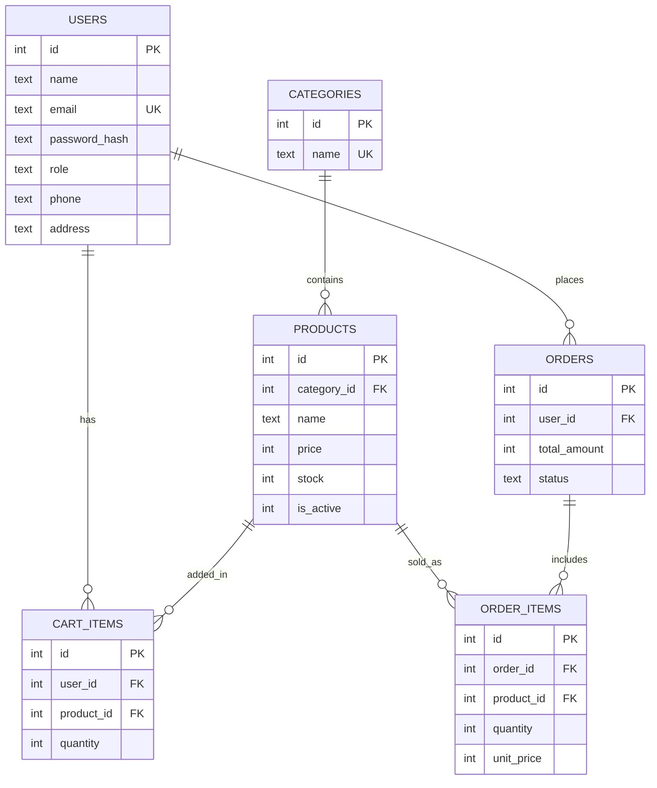

# ShopEasy – E-Commerce Application

ShopEasy is a simple full-stack online shopping MVP. Customers can browse products, search and filter them, add items to a cart and place a Cash on Delivery order. An admin can manage products, categories and orders.

**Tech stack:** HTML, CSS, JavaScript (frontend) · Node.js + Express (backend) · SQLite (better-sqlite3) · bcrypt + JWT (security)

## Features
- Register, login, logout, profile page
- Product list with search, category filter, sort and pagination
- Product detail page, out-of-stock products cannot be added
- Cart (add, update quantity, remove) with live navbar badge
- Checkout (COD only), order confirmation, My Orders, cancel order (stock restored)
- Admin panel: dashboard stats, product CRUD, category CRUD, order status update, low-stock highlight

## Setup
1. Install dependencies:
   ```
   npm install
   ```
2. Copy `.env.example` to `.env` and set your values.
3. Create tables and sample data (3 categories, 15 products, 1 admin):
   ```
   node server/seed.js
   ```
4. Start the server:
   ```
   npm run dev
   ```
5. Open http://localhost:3000

## Admin Login
- Email: admin@shopeasy.com
- Password: Admin@123

## API List
| Method | Endpoint | Description | Access |
| --- | --- | --- | --- |
| POST | /api/auth/register | Register new user | Public |
| POST | /api/auth/login | Login, returns JWT | Public |
| GET | /api/auth/me | Current user info | Logged in |
| PUT | /api/auth/me | Update profile | Logged in |
| GET | /api/products | List products (search, category, sort, page) | Public |
| GET | /api/products/:id | Product details | Public |
| POST | /api/products | Create product | Admin |
| PUT | /api/products/:id | Update product | Admin |
| DELETE | /api/products/:id | Deactivate product | Admin |
| GET | /api/categories | List categories | Public |
| POST | /api/categories | Create category | Admin |
| PUT | /api/categories/:id | Update category | Admin |
| DELETE | /api/categories/:id | Delete category | Admin |
| GET | /api/cart | Get my cart with totals | Customer |
| POST | /api/cart | Add item to cart | Customer |
| PUT | /api/cart/:itemId | Update quantity | Customer |
| DELETE | /api/cart/:itemId | Remove item | Customer |
| POST | /api/orders | Place order (DB transaction) | Customer |
| GET | /api/orders | My orders | Customer |
| GET | /api/orders/:id | Order detail with items | Customer |
| PUT | /api/orders/:id/cancel | Cancel order (status Placed) | Customer |
| GET | /api/admin/orders | All orders | Admin |
| PATCH | /api/admin/orders/:id/status | Update order status | Admin |
| GET | /api/admin/stats | Dashboard counts | Admin |

All APIs return JSON with status codes 200/201, 400, 401, 403, 404 and 500.

## ER Diagram


## Database Files
- `server/schema.sql` – table definitions
- `server/seed.sql` – sample data

Prices are stored in paise (integer).

## Author
Shifa Siddiqui